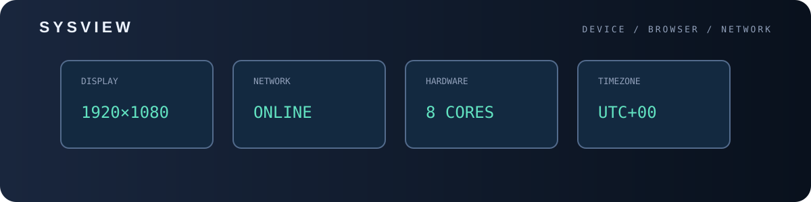

<div align="center">

<p align="center"></p>


**A zero-install dashboard that shows everything your browser reveals.**

[](https://error404dtir.github.io/sysview/)
[](LICENSE)


</div>

## What it shows

| Category | Details |
|---|---|
| **Screen** | Screen size, viewport (live), pixel ratio, color depth, orientation, color scheme, HDR |
| **Browser** | User agent, platform, languages, cookies, Do Not Track, PDF viewer, automation flag |
| **Hardware** | CPU threads, device memory, touch points, GPU renderer, pointer type, battery |
| **Network** | Public IP, country, city, ISP, connection type, downlink, RTT, data saver |
| **Time & Locale** | Time zone, UTC offset, locale, calendar, number format |
| **Storage & Page** | localStorage, IndexedDB, service workers, storage quota, referrer |
| **Feature support** | WebGL, WebGPU, WebAssembly, WebRTC, Bluetooth, Clipboard and more |

## Features

- Single `index.html`, no build step, no dependencies
- Live viewport updates while you resize the window
- Click any value to copy it, or export everything as JSON
- Dark and light themes
- Respects `prefers-reduced-motion`

## Privacy

All data is read locally from standard browser APIs. The only external requests are the public IP lookups (`ipwho.is`, with `ipify.org` as a fallback). Nothing is stored or sent to any server of ours.

## Run locally

```bash
git clone https://github.com/ERROR404DTIR/sysview.git
cd sysview
python -m http.server 8000
```

Then open <http://localhost:8000>.

## License

[MIT](LICENSE)